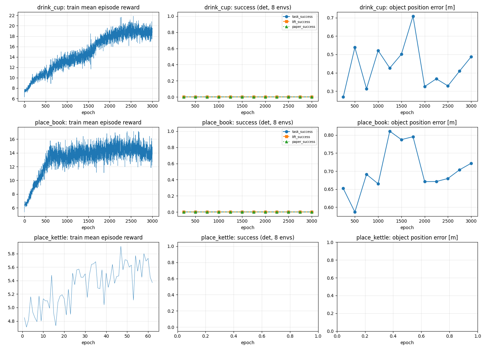

# SkillMimic-V2 Baseline 결과: Drink Cup / Place Book / Place Kettle

## 0. 진행 상태

| clip | 상태 | 다음 할 일 |
|---|---|---|
| Drink Cup (컵) | 완료 (3000 epoch, 평가 완료) | - |
| Place Book (책) | 완료 (3000 epoch, 평가 완료) | - |

## 1. 요약 (최종 체크포인트, 결정적 8 env)

| clip | epoch | 과제 성공 | 들어올림 성공 | 논문 지표 | 논문 SR (4090, 1.0B 샘플) | clip 중 넘어짐 | 과제 진행률 | 물체 오차 | 실패 frame 중앙값 | 참조 들기 시작 frame |
|---|---|---|---|---|---|---|---|---|---|---|
| Drink Cup (컵) | 3000 | 0% | 0% | 0% | 100% | 0% | 0.11 | 0.487 m | 14 | 33 |
| Place Book (책) | 3000 | 0% | 0% | 0% | 100% | 12% | 0.39 | 0.722 m | 68 | 57 |

## 2. 판정 

| clip | 구간 | 학습 보상 (전 → 후) | 보상 변화 | 과제 진행률 변화 (det) | 추세 |
|---|---|---|---|---|---|
| Drink Cup (컵) | 2000 → 3000 | 17.81 → 18.75 | +5.3% | -0.02 | 오름 |
| Place Book (책) | 2000 → 3000 | 14.42 → 14.06 | -2.5% | -0.06 | 평평 |

## 3. 학습 run

| clip | 저장된 epoch / 목표 | 샘플 (논문 1.0B 대비) | 학습 속도 | s/epoch | 학습 시간 | 최대 VRAM | 이어 학습 | 체크포인트 |
|---|---|---|---|---|---|---|---|---|
| Drink Cup (컵) | 3000 / 3000 | 197M (20%) | 6073 samples/s | 10.8 | 9.1 h | 11421 MiB | 3회 | 304개, 13.8 GB |
| Place Book (책) | 3000 / 3000 | 197M (20%) | 6600 samples/s | 9.9 | 8.3 h | 9968 MiB | 0회 | 304개, 13.8 GB |

설정: SkillMimic-V2 (SM + STF + ATS + HE + buffer node, STG 없음), 2048 env, seed 0, PPO는 논문 표 8과 같음. 학습 시간에 '(추정)'이 붙으면 기록 없이 끝난 구간(강제 종료, 진행 중)이 있어 GPU 로그 길이로 셌다.

## 4. 최종 체크포인트 상세

| clip | 평가 | epoch | n | 과제 성공 | 들어올림 성공 | 논문 지표 | clip 중 넘어짐 | 과제 진행률 | 물체 오차 | 몸 오차 | 최대 들어올림 | 들고 있던 frame |
|---|---|---|---|---|---|---|---|---|---|---|---|---|
| Drink Cup (컵) | 결정적 8 env | 3000 | 8 | 0.00 | 0.00 | 0.00 | 0.00 | 0.11 | 0.487 m | 0.229 m | 0.081 m | 3 |
| Drink Cup (컵) | 확률적 32 env | 3000 | 32 | 0.00 | 0.09 | 0.00 | 0.41 | 0.19 | 0.342 m | 0.480 m | 0.096 m | 9 |
| Drink Cup (컵) | 확률적 + 물체 교란 32 env | 3000 | 32 | 0.00 | 0.03 | 0.00 | 0.53 | 0.06 | 0.752 m | 0.511 m | 0.204 m | 5 |
| Place Book (책) | 결정적 8 env | 3000 | 8 | 0.00 | 0.00 | 0.00 | 0.12 | 0.39 | 0.722 m | 0.482 m | 0.044 m | 0 |
| Place Book (책) | 확률적 32 env | 3000 | 32 | 0.00 | 0.00 | 0.00 | 0.00 | 0.40 | 0.770 m | 0.526 m | 0.040 m | 0 |
| Place Book (책) | 확률적 + 물체 교란 32 env | 3000 | 32 | 0.00 | 0.00 | 0.00 | 0.03 | 0.28 | 0.773 m | 0.518 m | 0.039 m | 0 |

## 5. 학습 곡선 (결정적 8 env)

**Drink Cup (컵)**

| epoch | 학습 보상 | 과제 성공 | 들어올림 성공 | 논문 지표 | 넘어짐 | 과제 진행률 | 물체 오차 | 최대 들어올림 |
|---|---|---|---|---|---|---|---|---|
| 250 | 9.70 | 0.00 | 0.00 | 0.00 | 0.00 | 0.21 | 0.268 m | 0.048 m |
| 500 | 10.95 | 0.00 | 0.00 | 0.00 | 0.62 | 0.01 | 0.538 m | 0.066 m |
| 750 | 12.44 | 0.00 | 0.00 | 0.00 | 0.25 | 0.06 | 0.313 m | 0.053 m |
| 1000 | 13.19 | 0.00 | 0.00 | 0.00 | 0.00 | 0.04 | 0.521 m | 0.091 m |
| 1250 | 13.67 | 0.00 | 0.00 | 0.00 | 0.00 | 0.08 | 0.426 m | 0.059 m |
| 1500 | 14.84 | 0.00 | 0.00 | 0.00 | 0.00 | 0.04 | 0.501 m | 0.067 m |
| 1750 | 16.83 | 0.00 | 0.00 | 0.00 | 0.00 | 0.09 | 0.709 m | 0.071 m |
| 2000 | 17.86 | 0.00 | 0.00 | 0.00 | 0.00 | 0.13 | 0.325 m | 0.054 m |
| 2250 | 18.77 | 0.00 | 0.00 | 0.00 | 0.00 | 0.12 | 0.367 m | 0.056 m |
| 2500 | 18.99 | 0.00 | 0.00 | 0.00 | 0.25 | 0.14 | 0.329 m | 0.053 m |
| 2750 | 18.81 | 0.00 | 0.00 | 0.00 | 0.00 | 0.13 | 0.409 m | 0.064 m |
| 3000 | 18.85 | 0.00 | 0.00 | 0.00 | 0.00 | 0.11 | 0.487 m | 0.081 m |

**Place Book (책)**

| epoch | 학습 보상 | 과제 성공 | 들어올림 성공 | 논문 지표 | 넘어짐 | 과제 진행률 | 물체 오차 | 최대 들어올림 |
|---|---|---|---|---|---|---|---|---|
| 250 | 9.36 | 0.00 | 0.00 | 0.00 | 0.00 | 0.45 | 0.652 m | 0.039 m |
| 500 | 12.22 | 0.00 | 0.00 | 0.00 | 0.12 | 0.42 | 0.587 m | 0.043 m |
| 750 | 13.51 | 0.00 | 0.00 | 0.00 | 0.12 | 0.39 | 0.691 m | 0.039 m |
| 1000 | 13.27 | 0.00 | 0.00 | 0.00 | 0.00 | 0.45 | 0.665 m | 0.039 m |
| 1250 | 13.99 | 0.00 | 0.00 | 0.00 | 0.12 | 0.33 | 0.811 m | 0.039 m |
| 1500 | 13.84 | 0.00 | 0.00 | 0.00 | 0.12 | 0.33 | 0.787 m | 0.042 m |
| 1750 | 14.23 | 0.00 | 0.00 | 0.00 | 0.12 | 0.34 | 0.795 m | 0.043 m |
| 2000 | 14.37 | 0.00 | 0.00 | 0.00 | 0.00 | 0.45 | 0.671 m | 0.039 m |
| 2250 | 14.52 | 0.00 | 0.00 | 0.00 | 0.00 | 0.45 | 0.671 m | 0.039 m |
| 2500 | 14.53 | 0.00 | 0.00 | 0.00 | 0.00 | 0.45 | 0.680 m | 0.039 m |
| 2750 | 14.11 | 0.00 | 0.00 | 0.00 | 0.12 | 0.39 | 0.704 m | 0.045 m |
| 3000 | 14.00 | 0.00 | 0.00 | 0.00 | 0.12 | 0.39 | 0.722 m | 0.044 m |

