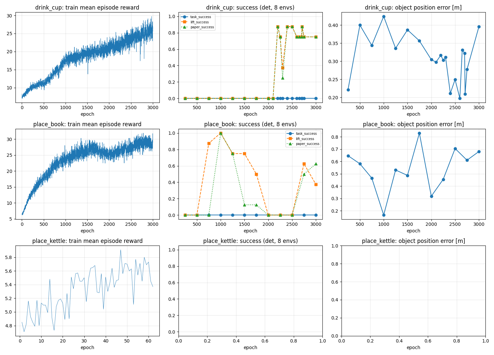

# SkillMimic-V2 Baseline 결과: Drink Cup / Place Book / Place Kettle

자동 생성 2026-10-12 12:13 · `repos/skillmimic-v2/write_results.sh` · 코드 `3a03564` · 실행과 상태 `SKILLMIMIC.md` · 규칙, 코드 변경, 컵 진단 `SKILLMIMIC_NOTES.md`

> 자동 생성 문서. `cd repos/skillmimic-v2 && bash write_results.sh`는 기존 문서를 덮어쓰지 않고 다음 번호의 새 문서 (`BASELINE_SKILLMIMIC_2.md`, `_3.md`, ...)를 만든다.

## 0. 진행 상태

| clip | 상태 | 다음 할 일 |
|---|---|---|
| Drink Cup (컵) | 완료 (3000 epoch, 평가 완료) | - |
| Place Book (책) | 완료 (3000 epoch, 평가 완료) | - |
| Place Kettle (주전자) | 보류 (60/3000 epoch에서 멈춤) | 컵, 책 결과를 보고 결정 |

## 1. 요약 (최종 체크포인트, 결정적 8 env)

| clip | epoch | 과제 성공 | 들어올림 성공 | 논문 지표 | 논문 SR (4090, 1.0B 샘플) | clip 중 넘어짐 | 과제 진행률 | 물체 오차 | 실패 frame 중앙값 | 참조 들기 시작 frame |
|---|---|---|---|---|---|---|---|---|---|---|
| Drink Cup (컵) | 3000 | 0% | 75% | 75% | 100% | 25% | 0.19 | 0.396 m | 44 | 33 |
| Place Book (책) | 3000 | 0% | 38% | 62% | 100% | 12% | 0.42 | 0.681 m | 67 | 57 |
| Place Kettle (주전자) | - | - | - | - | 100% | - | - | - | - | - |

- 과제 성공: clip의 모든 frame에서 물체가 참조 위치 10 cm 안 **그리고** 넘어지지 않음 (T09 `task_success`와 같은 정의). 들어올림 성공: 참조 들어올림 높이의 50% 이상 들고 그때 손목 0.2 m 안. 논문 지표: 업스트림 metric (참고용).
- 실패 frame: 처음으로 물체 오차 10 cm 초과 또는 넘어진 frame (실패한 episode만). 참조 들기 시작: 참조 물체가 2 cm 넘게 올라간 첫 frame. 두 값은 같은 시간축이라 실패가 **들기 전/중/후** 어디서 나는지 바로 비교된다.

## 2. 판정 (SKILLMIMIC_NOTES.md 1.4, 결과를 보기 전에 정한 규칙을 그대로 적용)

**잠정**: 아직 끝나지 않은 run이 있다. 세 run이 모두 끝나고 평가까지 되면 확정된다.

- 결과: clip 하나 이상에서 과제 성공 또는 들어올림 성공 ≥ 0.5 (최고 0.75).
- 해석: **12GB/RTX 5070은 이 종류의 과제(ParaHome 물체 잡고 들기)에 근본적 장애가 아니다.** T09(WristMimic) 0%의 주원인은 하드웨어가 아니라 방법/학습 구조 쪽이다 (H-task).

곡선 추세 (오름 = 보상 +1% 이상 **또는** 과제 진행률 +0.05 이상, 마지막 1000 epoch 기준):

| clip | 구간 | 학습 보상 (전 → 후) | 보상 변화 | 과제 진행률 변화 (det) | 추세 |
|---|---|---|---|---|---|
| Drink Cup (컵) | 2000 → 3000 | 21.04 → 25.31 | +20.3% | 0.00 | 오름 |
| Place Book (책) | 2000 → 3000 | 25.45 → 28.66 | +12.6% | -0.01 | 오름 |

## 3. 학습 run

| clip | 저장된 epoch / 목표 | 샘플 (논문 1.0B 대비) | 학습 속도 | s/epoch | 학습 시간 | 최대 VRAM | 이어 학습 | 체크포인트 |
|---|---|---|---|---|---|---|---|---|
| Drink Cup (컵) | 3000 / 3000 | 197M (20%) | 6070 samples/s | 10.8 | 9.1 h (추정) | 11548 MiB | 4회 | 304개, 13.8 GB |
| Place Book (책) | 3000 / 3000 | 197M (20%) | 6756 samples/s | 9.7 | 8.1 h | 9275 MiB | 0회 | 304개, 13.8 GB |
| Place Kettle (주전자) | 60 / 3000 | 4M (0%) | 5808 samples/s | 11.3 | 0.2 h | 9831 MiB | 0회 | 9개, 0.4 GB |

설정: SkillMimic-V2 (SM + STF + ATS + HE + buffer node, STG 없음), 2048 env, seed 0, PPO는 논문 표 8과 같음. Drink Cup은 고친 환경 (6절). 학습 시간에 '(추정)'이 붙으면 기록 없이 끝난 구간(강제 종료, 진행 중)이 있어 GPU 로그 길이로 셌다.

## 4. 최종 체크포인트 상세

논문 ε-NSR (SM + Ours): Drink Cup 33.9%, Place Book 82.4%, Place Kettle 49.9%. 우리 교란 평가는 확률적 행동이라 논문(결정적)보다 엄격하다.

| clip | 평가 | epoch | n | 과제 성공 | 들어올림 성공 | 논문 지표 | clip 중 넘어짐 | 과제 진행률 | 물체 오차 | 몸 오차 | 최대 들어올림 | 들고 있던 frame |
|---|---|---|---|---|---|---|---|---|---|---|---|---|
| Drink Cup (컵) | 결정적 8 env | 3000 | 8 | 0.00 | 0.75 | 0.75 | 0.25 | 0.19 | 0.396 m | 0.356 m | 0.604 m | 96 |
| Drink Cup (컵) | 확률적 32 env | 3000 | 32 | 0.00 | 0.59 | 0.59 | 0.34 | 0.19 | 0.312 m | 0.226 m | 0.457 m | 70 |
| Drink Cup (컵) | 확률적 + 물체 교란 32 env | 3000 | 32 | 0.00 | 0.03 | 0.03 | 0.03 | 0.16 | 0.330 m | 0.191 m | 0.034 m | 4 |
| Place Book (책) | 결정적 8 env | 3000 | 8 | 0.00 | 0.38 | 0.62 | 0.12 | 0.42 | 0.681 m | 0.489 m | 0.262 m | 126 |
| Place Book (책) | 확률적 32 env | 3000 | 32 | 0.00 | 0.28 | 0.22 | 0.06 | 0.40 | 0.853 m | 0.576 m | 0.190 m | 75 |
| Place Book (책) | 확률적 + 물체 교란 32 env | 3000 | 32 | 0.00 | 0.19 | 0.16 | 0.06 | 0.39 | 0.840 m | 0.573 m | 0.132 m | 51 |

## 5. 학습 곡선 (결정적 8 env)

**Drink Cup (컵)**

| epoch | 학습 보상 | 과제 성공 | 들어올림 성공 | 논문 지표 | 넘어짐 | 과제 진행률 | 물체 오차 | 최대 들어올림 |
|---|---|---|---|---|---|---|---|---|
| 250 | 10.29 | 0.00 | 0.00 | 0.00 | 1.00 | 0.20 | 0.221 m | -0.001 m |
| 500 | 11.12 | 0.00 | 0.00 | 0.00 | 1.00 | 0.20 | 0.400 m | -0.001 m |
| 750 | 14.24 | 0.00 | 0.00 | 0.00 | 0.00 | 0.18 | 0.344 m | 0.010 m |
| 1000 | 17.66 | 0.00 | 0.00 | 0.00 | 0.62 | 0.18 | 0.424 m | 0.007 m |
| 1250 | 18.49 | 0.00 | 0.00 | 0.00 | 0.88 | 0.19 | 0.336 m | 0.001 m |
| 1500 | 19.20 | 0.00 | 0.00 | 0.00 | 0.75 | 0.17 | 0.387 m | 0.002 m |
| 1750 | 20.05 | 0.00 | 0.00 | 0.00 | 0.50 | 0.19 | 0.357 m | 0.001 m |
| 2000 | 21.12 | 0.00 | 0.00 | 0.00 | 0.00 | 0.19 | 0.305 m | -0.000 m |
| 2100 | 21.47 | 0.00 | 0.00 | 0.00 | 0.00 | 0.19 | 0.298 m | 0.000 m |
| 2200 | 21.67 | 0.00 | 0.88 | 0.88 | 0.00 | 0.19 | 0.317 m | 0.678 m |
| 2250 | 21.62 | 0.00 | 0.75 | 0.75 | 0.00 | 0.16 | 0.303 m | 0.587 m |
| 2300 | 22.41 | 0.00 | 0.38 | 0.25 | 0.12 | 0.21 | 0.311 m | 0.328 m |
| 2400 | 23.04 | 0.00 | 0.88 | 0.88 | 0.00 | 0.23 | 0.211 m | 0.763 m |
| 2500 | 23.27 | 0.00 | 0.88 | 0.88 | 0.00 | 0.20 | 0.250 m | 0.743 m |
| 2600 | 24.00 | 0.00 | 0.75 | 0.75 | 0.00 | 0.22 | 0.197 m | 0.602 m |
| 2650 | 24.37 | 0.00 | 0.75 | 0.75 | 0.00 | 0.18 | 0.331 m | 0.599 m |
| 2700 | 23.92 | 0.00 | 0.75 | 0.75 | 0.12 | 0.19 | 0.322 m | 0.589 m |
| 2710 | 24.01 | 0.00 | 0.88 | 0.88 | 0.00 | 0.23 | 0.210 m | 0.683 m |
| 2750 | 25.18 | 0.00 | 0.75 | 0.75 | 0.12 | 0.20 | 0.277 m | 0.580 m |
| 3000 | 25.76 | 0.00 | 0.75 | 0.75 | 0.25 | 0.19 | 0.396 m | 0.604 m |

**Place Book (책)**

| epoch | 학습 보상 | 과제 성공 | 들어올림 성공 | 논문 지표 | 넘어짐 | 과제 진행률 | 물체 오차 | 최대 들어올림 |
|---|---|---|---|---|---|---|---|---|
| 250 | 13.52 | 0.00 | 0.00 | 0.00 | 0.00 | 0.44 | 0.648 m | 0.000 m |
| 500 | 17.83 | 0.00 | 0.00 | 0.00 | 0.12 | 0.41 | 0.582 m | 0.026 m |
| 750 | 21.72 | 0.00 | 0.88 | 0.00 | 0.12 | 0.52 | 0.466 m | 0.378 m |
| 1000 | 23.71 | 0.00 | 1.00 | 1.00 | 0.88 | 0.62 | 0.166 m | 0.408 m |
| 1250 | 25.22 | 0.00 | 0.75 | 0.75 | 0.50 | 0.46 | 0.531 m | 0.323 m |
| 1500 | 26.25 | 0.00 | 0.75 | 0.12 | 1.00 | 0.42 | 0.487 m | 0.350 m |
| 1750 | 26.41 | 0.00 | 0.50 | 0.12 | 0.25 | 0.33 | 0.831 m | 0.191 m |
| 2000 | 25.39 | 0.00 | 0.00 | 0.00 | 1.00 | 0.42 | 0.319 m | 0.013 m |
| 2250 | 26.32 | 0.00 | 0.00 | 0.00 | 1.00 | 0.44 | 0.455 m | 0.040 m |
| 2500 | 27.24 | 0.00 | 0.00 | 0.00 | 0.25 | 0.44 | 0.706 m | 0.066 m |
| 2750 | 28.61 | 0.00 | 0.62 | 0.50 | 0.12 | 0.39 | 0.611 m | 0.237 m |
| 3000 | 28.32 | 0.00 | 0.38 | 0.62 | 0.12 | 0.42 | 0.681 m | 0.262 m |



## 5-1. Drink Cup (컵): 업스트림 환경 vs 고친 환경

업스트림 환경 run `drink_cup_ours_n2048_s0` (3000 epoch)과 고친 환경 run `drink_cup_fix_n2048_s0`. 무엇을 왜 고쳤는지: `SKILLMIMIC_NOTES.md` 4절.

| epoch | 환경 | 과제 성공 | 들어올림 성공 | 논문 지표 | 과제 진행률 | 물체 오차 | 최대 들어올림 | 들고 있던 frame |
|---|---|---|---|---|---|---|---|---|
| 250 | 업스트림 | 0.00 | 0.00 | 0.00 | 0.21 | 0.268 m | 0.048 m | 0 |
| 250 | 고침 | 0.00 | 0.00 | 0.00 | 0.20 | 0.221 m | -0.001 m | 0 |
| 500 | 업스트림 | 0.00 | 0.00 | 0.00 | 0.01 | 0.538 m | 0.066 m | 0 |
| 500 | 고침 | 0.00 | 0.00 | 0.00 | 0.20 | 0.400 m | -0.001 m | 0 |
| 750 | 업스트림 | 0.00 | 0.00 | 0.00 | 0.06 | 0.313 m | 0.053 m | 0 |
| 750 | 고침 | 0.00 | 0.00 | 0.00 | 0.18 | 0.344 m | 0.010 m | 0 |
| 1000 | 업스트림 | 0.00 | 0.00 | 0.00 | 0.04 | 0.521 m | 0.091 m | 0 |
| 1000 | 고침 | 0.00 | 0.00 | 0.00 | 0.18 | 0.424 m | 0.007 m | 0 |
| 1250 | 업스트림 | 0.00 | 0.00 | 0.00 | 0.08 | 0.426 m | 0.059 m | 0 |
| 1250 | 고침 | 0.00 | 0.00 | 0.00 | 0.19 | 0.336 m | 0.001 m | 0 |
| 1500 | 업스트림 | 0.00 | 0.00 | 0.00 | 0.04 | 0.501 m | 0.067 m | 0 |
| 1500 | 고침 | 0.00 | 0.00 | 0.00 | 0.17 | 0.387 m | 0.002 m | 0 |
| 1750 | 업스트림 | 0.00 | 0.00 | 0.00 | 0.09 | 0.709 m | 0.071 m | 0 |
| 1750 | 고침 | 0.00 | 0.00 | 0.00 | 0.19 | 0.357 m | 0.001 m | 0 |
| 2000 | 업스트림 | 0.00 | 0.00 | 0.00 | 0.13 | 0.325 m | 0.054 m | 0 |
| 2000 | 고침 | 0.00 | 0.00 | 0.00 | 0.19 | 0.305 m | -0.000 m | 0 |
| 2100 | 고침 | 0.00 | 0.00 | 0.00 | 0.19 | 0.298 m | 0.000 m | 0 |
| 2200 | 고침 | 0.00 | 0.88 | 0.88 | 0.19 | 0.317 m | 0.678 m | 94 |
| 2250 | 업스트림 | 0.00 | 0.00 | 0.00 | 0.12 | 0.367 m | 0.056 m | 0 |
| 2250 | 고침 | 0.00 | 0.75 | 0.75 | 0.16 | 0.303 m | 0.587 m | 93 |
| 2300 | 고침 | 0.00 | 0.38 | 0.25 | 0.21 | 0.311 m | 0.328 m | 29 |
| 2400 | 고침 | 0.00 | 0.88 | 0.88 | 0.23 | 0.211 m | 0.763 m | 101 |
| 2500 | 업스트림 | 0.00 | 0.00 | 0.00 | 0.14 | 0.329 m | 0.053 m | 0 |
| 2500 | 고침 | 0.00 | 0.88 | 0.88 | 0.20 | 0.250 m | 0.743 m | 108 |
| 2600 | 고침 | 0.00 | 0.75 | 0.75 | 0.22 | 0.197 m | 0.602 m | 90 |
| 2650 | 고침 | 0.00 | 0.75 | 0.75 | 0.18 | 0.331 m | 0.599 m | 85 |
| 2700 | 고침 | 0.00 | 0.75 | 0.75 | 0.19 | 0.322 m | 0.589 m | 89 |
| 2710 | 고침 | 0.00 | 0.88 | 0.88 | 0.23 | 0.210 m | 0.683 m | 106 |
| 2750 | 업스트림 | 0.00 | 0.00 | 0.00 | 0.13 | 0.409 m | 0.064 m | 0 |
| 2750 | 고침 | 0.00 | 0.75 | 0.75 | 0.20 | 0.277 m | 0.580 m | 99 |
| 3000 | 업스트림 | 0.00 | 0.00 | 0.00 | 0.11 | 0.487 m | 0.081 m | 3 |
| 3000 | 고침 | 0.00 | 0.75 | 0.75 | 0.19 | 0.396 m | 0.604 m | 96 |

## 5-1. Place Book (책): 업스트림 환경 vs 고친 환경

업스트림 환경 run `place_book_ours_n2048_s0` (3000 epoch)과 고친 환경 run `place_book_fix_n2048_s0`. 무엇을 왜 고쳤는지: `SKILLMIMIC_NOTES.md` 4절.

| epoch | 환경 | 과제 성공 | 들어올림 성공 | 논문 지표 | 과제 진행률 | 물체 오차 | 최대 들어올림 | 들고 있던 frame |
|---|---|---|---|---|---|---|---|---|
| 250 | 업스트림 | 0.00 | 0.00 | 0.00 | 0.45 | 0.652 m | 0.039 m | 0 |
| 250 | 고침 | 0.00 | 0.00 | 0.00 | 0.44 | 0.648 m | 0.000 m | 0 |
| 500 | 업스트림 | 0.00 | 0.00 | 0.00 | 0.42 | 0.587 m | 0.043 m | 0 |
| 500 | 고침 | 0.00 | 0.00 | 0.00 | 0.41 | 0.582 m | 0.026 m | 0 |
| 750 | 업스트림 | 0.00 | 0.00 | 0.00 | 0.39 | 0.691 m | 0.039 m | 0 |
| 750 | 고침 | 0.00 | 0.88 | 0.00 | 0.52 | 0.466 m | 0.378 m | 39 |
| 1000 | 업스트림 | 0.00 | 0.00 | 0.00 | 0.45 | 0.665 m | 0.039 m | 0 |
| 1000 | 고침 | 0.00 | 1.00 | 1.00 | 0.62 | 0.166 m | 0.408 m | 74 |
| 1250 | 업스트림 | 0.00 | 0.00 | 0.00 | 0.33 | 0.811 m | 0.039 m | 0 |
| 1250 | 고침 | 0.00 | 0.75 | 0.75 | 0.46 | 0.531 m | 0.323 m | 62 |
| 1500 | 업스트림 | 0.00 | 0.00 | 0.00 | 0.33 | 0.787 m | 0.042 m | 0 |
| 1500 | 고침 | 0.00 | 0.75 | 0.12 | 0.42 | 0.487 m | 0.350 m | 49 |
| 1750 | 업스트림 | 0.00 | 0.00 | 0.00 | 0.34 | 0.795 m | 0.043 m | 0 |
| 1750 | 고침 | 0.00 | 0.50 | 0.12 | 0.33 | 0.831 m | 0.191 m | 40 |
| 2000 | 업스트림 | 0.00 | 0.00 | 0.00 | 0.45 | 0.671 m | 0.039 m | 0 |
| 2000 | 고침 | 0.00 | 0.00 | 0.00 | 0.42 | 0.319 m | 0.013 m | 0 |
| 2250 | 업스트림 | 0.00 | 0.00 | 0.00 | 0.45 | 0.671 m | 0.039 m | 0 |
| 2250 | 고침 | 0.00 | 0.00 | 0.00 | 0.44 | 0.455 m | 0.040 m | 0 |
| 2500 | 업스트림 | 0.00 | 0.00 | 0.00 | 0.45 | 0.680 m | 0.039 m | 0 |
| 2500 | 고침 | 0.00 | 0.00 | 0.00 | 0.44 | 0.706 m | 0.066 m | 13 |
| 2750 | 업스트림 | 0.00 | 0.00 | 0.00 | 0.39 | 0.704 m | 0.045 m | 0 |
| 2750 | 고침 | 0.00 | 0.62 | 0.50 | 0.39 | 0.611 m | 0.237 m | 74 |
| 3000 | 업스트림 | 0.00 | 0.00 | 0.00 | 0.39 | 0.722 m | 0.044 m | 0 |
| 3000 | 고침 | 0.00 | 0.38 | 0.62 | 0.42 | 0.681 m | 0.262 m | 126 |

## 6. 읽을 때 주의

- **Drink Cup과 Place Book은 고친 환경(method `fix`)의 결과다.** 업스트림 환경에서는 가구 충돌 형상이 거칠어 물체가 참조보다 높게 놓이고(컵 4.2 cm, 튕김; 책 3.8 cm), 물체가 비현실적으로 무겁고(컵 1.49 kg, 책 7.1 kg), history encoder 입력 배치 버그와 위상 정보 없음 때문에 학습이 막혔다 (`SKILLMIMIC_NOTES.md` 4절). PPO, 보상, STF/ATS/HE/buffer node는 같고, 위상 관측(논문 SM+T와 같은 입력)과 학습 중 조기 종료(물체가 참조에서 0.25 m 이상 벗어나면)가 더해졌다. 평가 규칙은 그대로다. 업스트림 환경 run은 5-1절에 나란히 둔다.
- **들어올림 성공과 논문 지표는 컵을 들었는지, 과제 성공은 모든 frame에서 물체 오차 ≤ 10 cm인지를 본다.** 들기는 되지만 타이밍이 어긋나면(예: 늦게 내림) 과제 성공은 0이 된다. 구간별 오차는 frame별 궤적(npz)에 있다.
- Place Kettle은 보류 (업스트림 환경, epoch 60에서 멈춤).
- **논문 재현이 아니다.** 예산은 clip당 3000 epoch = 1.97억 샘플로 논문(약 1.0B)의 20%다 (T09 WristMimic baseline과 같은 샘플 수). GPU는 RTX 5070 12GB.
- 결정적 평가도 GPU PhysX가 비트 단위로 재현되지 않아 8 env를 돌린다. 8 env의 해상도는 0.125이므로 그보다 작은 차이는 '차이 없음'으로 본다.
- 학습에서 episode는 넘어질 때(고친 환경은 물체가 0.25 m 넘게 벗어날 때도) 끝나고 60 frame마다 랜덤 frame에서 다시 시작한다. 평가는 frame 2에서 시작해 300 step, 처음 넘어지면 그 env는 끝.
- Place Kettle 참조 자체가 논문 지표의 '60 frame 이상' 조건을 45 frame만 만족한다 (`SKILLMIMIC_NOTES.md` 5절).
- 학습 clip = 평가 clip. 일반화나 실제 로봇 성공을 주장하지 않는다.

## 7. 원자료와 재현

| 무엇 | 위치 (`repos/skillmimic-v2/` 기준) |
|---|---|
| 체크포인트 (10 epoch마다), train.log, gpu.csv, run_meta.json | `experiments/runs/<run>/` (git 제외). run: `drink_cup_fix_n2048_s0`, `place_book_fix_n2048_s0` (+ 비교용 업스트림 환경 `drink_cup_ours_n2048_s0`, `place_book_ours_n2048_s0`), 보류 `place_kettle_ours_n2048_s0` |
| 체크포인트별 env별 지표, frame별 궤적 | `experiments/results/eval/<det|stoch|stoch_perturb>/<run>/*.json, *.npz` |
| 표 (csv), 그림 | `experiments/results/tables/`, `experiments/results/figures/` |

```bash
cd repos/skillmimic-v2
bash run_all.sh                                             # 컵 -> 책 -> 이 문서. 끊겨도 같은 명령으로 이어서
bash write_results.sh                                       # 이 파일
```
